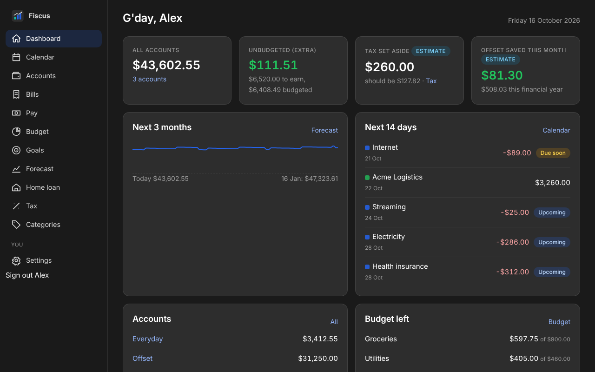
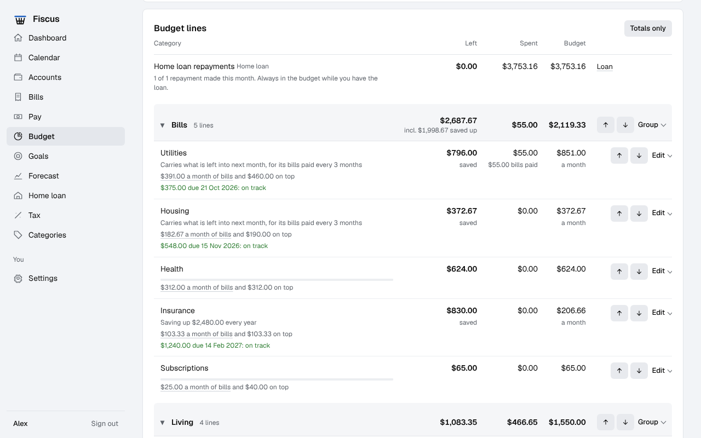
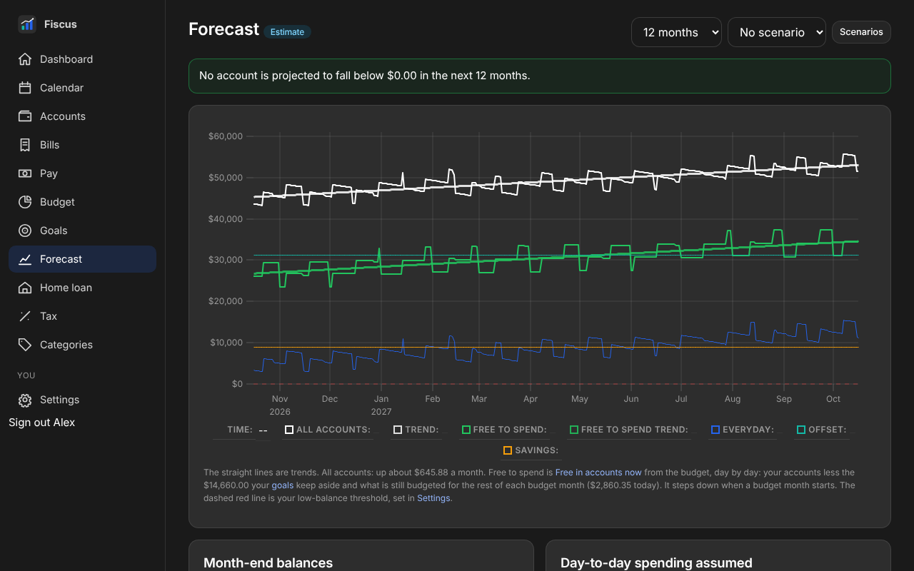
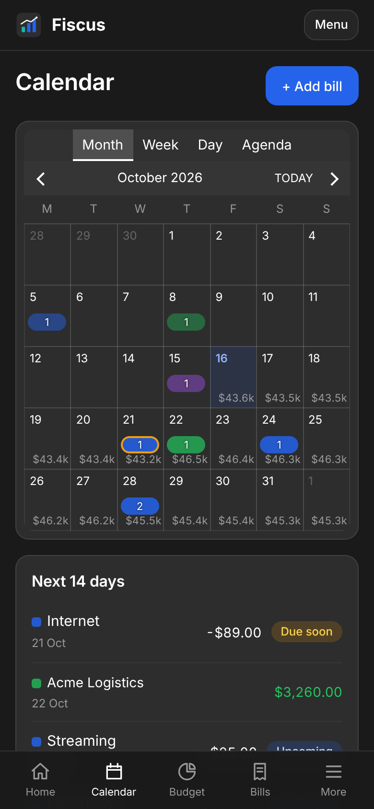
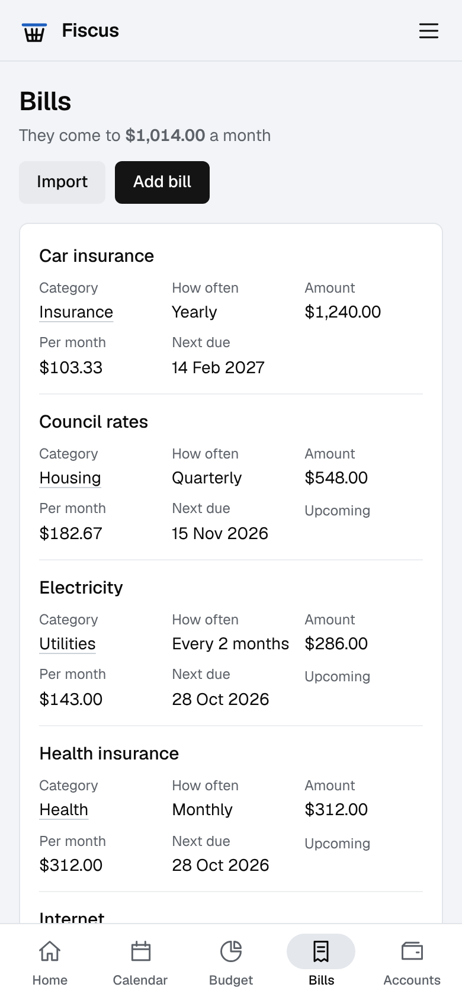
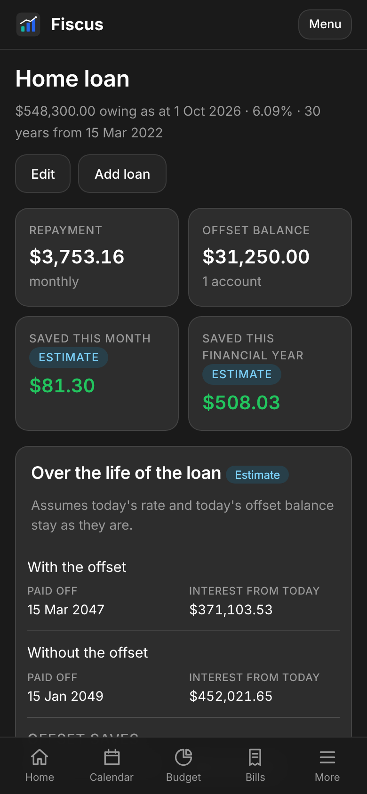

<h1 align="center">Fiscus</h1>

<p align="center">
  <strong>Self-hosted personal finance for an Australian household.</strong><br>
  Budget, bills, pay, home loan, forecast and tax in one place, on your own server and on your phone.
</p>

<p align="center">
  
  
  
  
</p>

<p align="center">
  
</p>

## Features

- **A budget you keep by hand.** The month starts on payday. Take spending off
  as you go, save up for yearly costs a month at a time, and pay bills out of
  their budget lines.
- **Bills on a calendar**, with due-soon and overdue reminders, marked paid in
  a tap.
- **Accounts as your bank shows them.** Type balances in from your banking app;
  bills, pay and spending move them in between. Savings goals live inside your
  real accounts.
- **Pay and payslips**, typed in or read from PDFs, each matched to its payday.
- **A forecast** up to 24 months ahead, with its trend, what is free to spend
  and what-if scenarios.
- **Home loan with offset**: repayments, interest saved and the payoff date.
- **A tax estimate** for the financial year, against what you have set aside.
- **Private by design.** One container and one SQLite file. Passkey sign-in, no
  telemetry, and no outside calls unless you turn on reminders through
  [ntfy](https://ntfy.sh).

Forecast and tax figures are estimates from your own data, not financial or
tax advice.

## Screenshots

<table>
  <tr>
    <td width="50%"></td>
    <td width="50%"></td>
  </tr>
  <tr>
    <td align="center"><sub>Budget lines, grouped, with yearly costs saved up</sub></td>
    <td align="center"><sub>A year ahead, with the trend and what is free to spend</sub></td>
  </tr>
</table>

<table>
  <tr>
    <td width="33%"></td>
    <td width="33%"></td>
    <td width="33%"></td>
  </tr>
  <tr>
    <td align="center"><sub>Bills and paydays, with the balance each day</sub></td>
    <td align="center"><sub>Every recurring cost in one place</sub></td>
    <td align="center"><sub>What the offset saves</sub></td>
  </tr>
</table>

## Quick start

You need Docker and a domain served over **HTTPS** by a reverse proxy.
Passkeys and the installable app only work over HTTPS.

```bash
mkdir fiscus && cd fiscus
curl -O https://raw.githubusercontent.com/f3nici/fiscus/main/docker-compose.yml
curl -o .env https://raw.githubusercontent.com/f3nici/fiscus/main/.env.example
# In .env, set FISCUS_BASE_URL
docker compose up -d
docker compose logs fiscus   # prints a one-time setup link
```

Open the setup link on your phone, choose a username and create a passkey.
Then add Fiscus to your home screen: **Share, Add to Home Screen** in Safari,
or **Install app** in Chrome.

The [guide](docs/guide.md) covers Dockge, the reverse proxy, importing a
budget or bills, reminders and every setting.

## Backups and recovery

The database is copied to `/data/backups` every night and kept for 14 days.
Download a copy at any time from **Settings**; restoring one is covered in the
[guide](docs/guide.md#backup-and-restore).

Lost every passkey? This prints a one-time recovery link:

```bash
docker compose exec fiscus python -m fiscus.cli recovery-link <username>
```

## Development

```bash
uv venv -p 3.12 .venv && . .venv/bin/activate
uv pip install --require-hashes -r requirements-dev.lock
FISCUS_DATA_DIR=./data FISCUS_BASE_URL=http://localhost:8000 python -m fiscus
pytest
```

Python 3.12, FastAPI, SQLAlchemy on SQLite, and Jinja2 with HTMX. The design
notes are in [`docs/`](docs), and [`CLAUDE.md`](CLAUDE.md) lists the rules the
tests hold.

## Licence

[PolyForm Noncommercial 1.0.0](LICENSE), copyright Fenici. Free for
noncommercial use, including running it for your own household. Bundled: htmx
(0BSD), uPlot (MIT), vue-cal's stylesheet (MIT) and Inter (OFL).
